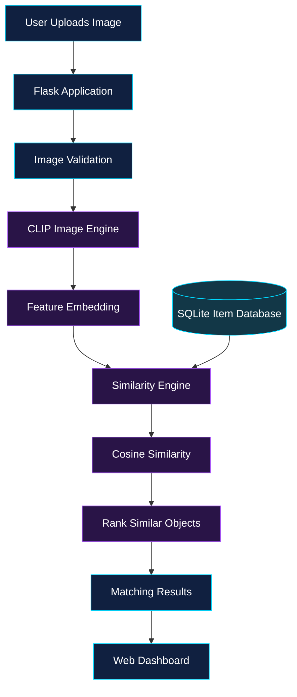

# ◈ NEURAL FIND — AI LOST & FOUND FINDER

<div align="center">


### FIND LOST OBJECTS WITH ARTIFICIAL INTELLIGENCE

*An intelligent visual search platform that discovers visually similar objects using deep learning and computer vision.*

<br/>


<br/>

[OVERVIEW](#-overview) • [FEATURES](#-features) • [ARCHITECTURE](#-architecture) • [INSTALLATION](#-installation)

</div>

---

## ◈ 01 — PROJECT OVERVIEW

**NEURAL FIND** is an AI-powered lost and found platform that uses image similarity to help people locate missing objects.

Users can register lost or found objects by uploading photographs and entering descriptions.

When someone uploads an image of a missing object, the system uses the CLIP vision model to extract visual embeddings and compares them with registered found-item photographs.

The application then ranks visually similar objects.

### The problem we solve

Traditional lost and found systems depend heavily on text descriptions. Different people may describe the same object in different ways.

NEURAL FIND introduces visual search to make object discovery easier.

---

## ◈ 02 — CORE FEATURES

| Feature | Description |
|:---|:---|
| Image Upload | Upload object photographs |
| Lost Item Reporting | Register missing objects |
| Found Item Reporting | Register discovered objects |
| AI Image Analysis | Extract visual embeddings |
| Similarity Search | Compare image representations |
| Match Ranking | Display closest visual matches |
| Flask Dashboard | Web-based interface |
| SQLite Database | Store item information |
| Item Resolution | Mark records as resolved |

---

## ◈ 03 — HOW IT WORKS

```text
       USER UPLOADS IMAGE
               |
               ▼
       IMAGE VALIDATION
               |
               ▼
        CLIP AI MODEL
               |
               ▼
      IMAGE EMBEDDING
               |
               ▼
      SIMILARITY ENGINE
               |
               ▼
      SEARCH FOUND ITEMS
               |
               ▼
       COSINE SIMILARITY
               |
               ▼
        RANK RESULTS
               |
               ▼
       DISPLAY MATCHES
```

---

## ◈ 04 — SYSTEM ARCHITECTURE



---

## ◈ 05 — TECHNOLOGY STACK

| Technology | Purpose |
|:---|:---|
| Python | Backend programming |
| Flask | Web application |
| OpenAI CLIP | Visual feature extraction |
| PyTorch | Deep learning inference |
| Transformers | Pretrained model integration |
| OpenCV | Image processing |
| Pillow | Image validation |
| NumPy | Vector mathematics |
| SQLite | Data management |
| HTML5 | Frontend structure |
| CSS3 | Neon interface design |

---

## ◈ 06 — PROJECT STRUCTURE

```text
AI-Lost-and-Found-Finder/
│
├── app.py
├── config.py
├── database.py
├── image_engine.py
├── similarity.py
├── requirements.txt
├── .gitignore
│
├── templates/
│   └── index.html
│
├── static/
│   └── style.css
│
├── uploads/
│
└── README.md
```

---

## ◈ 07 — INSTALLATION

### Requirements

- Python 3.10+
- Git
- Internet connection for initial model download
- Recommended: 8 GB RAM or more
- Optional: compatible CUDA GPU

### Step 1 — Clone the repository

```bash
git clone YOUR_REPOSITORY_URL
```

### Step 2 — Open the project

```bash
cd AI-Lost-and-Found-Finder
```

### Step 3 — Create a virtual environment

```bash
python -m venv .venv
```

### Step 4 — Activate the environment

**Windows**

```bash
.venv\Scripts\activate
```

**Linux / macOS**

```bash
source .venv/bin/activate
```

### Step 5 — Install dependencies

```bash
pip install -r requirements.txt
```

---

## ◈ 08 — RUN THE APPLICATION

Start the Flask application:

```bash
python app.py
```

Open your browser:

```text
http://127.0.0.1:5000
```

The initial launch downloads the pretrained CLIP model if it is not already cached.

---

## ◈ 09 — AI IMAGE MATCHING

The application uses CLIP image embeddings to represent visual information numerically.

It compares two image embeddings using cosine similarity.

### Mathematical formula

\[
Similarity(A,B)=\frac{A\cdot B}{\|A\|\|B\|}
\]

### Search workflow

1. Upload a photograph of a lost object.
2. Extract its CLIP image embedding.
3. Retrieve registered found-object images.
4. Extract their image embeddings.
5. Calculate cosine similarity.
6. Sort results from highest to lowest similarity.
7. Display the top matching objects.

**Important:** Visual similarity does not establish that two photographs show the same physical object. Similarity percentages are not probabilities or verified match confidence.

---

## ◈ 10 — DATABASE DESIGN

The SQLite database stores:

| Column | Purpose |
|:---|:---|
| id | Unique record ID |
| item_name | Object name |
| description | Object description |
| category | Object category |
| location | Reported location |
|
